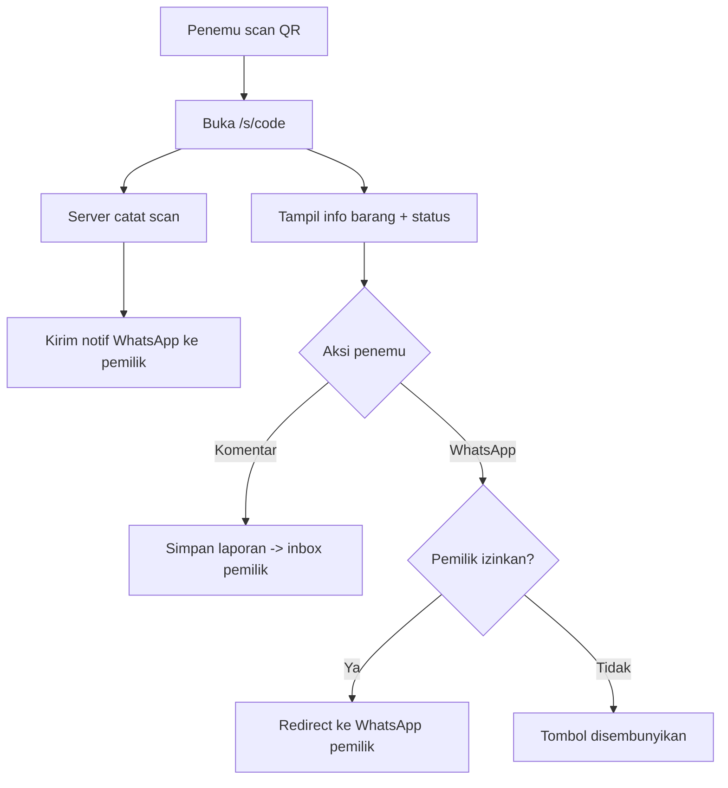

# PRD: Website Barang Hilang Berbasis Stiker QR/Barcode

**Versi:** 1.0 | **Status:** Draft | **Tanggal:** 8 November 2026

---

## 1. Ringkasan Produk

Pemilik barang menempelkan stiker QR pada barang miliknya (tas, dompet, laptop, kunci, dll). Jika barang hilang dan ditemukan orang lain, penemu cukup scan stiker. Penemu melihat info barang dan pesan dari pemilik, bisa meninggalkan komentar sebagai laporan, dan bisa menghubungi pemilik via WhatsApp **hanya jika pemilik mengizinkan**. Setiap scan memicu notifikasi WhatsApp ke pemilik.

**Prinsip utama:**
- Penemu tidak perlu login/daftar.
- Privasi pemilik terjaga: nomor WhatsApp tidak pernah ditampilkan mentah ke publik.
- Pemilik mengontrol penuh status barang (Aman / Hilang).

---

## 2. Core Features

### 2.1 Halaman Publik (Penemu / Orang yang Scan)
| # | Fitur | Deskripsi |
|---|-------|-----------|
| P1 | Halaman info barang | Menampilkan nama pemilik, foto barang, ciri-ciri barang, pesan dari pemilik, dan badge status (Aman / Hilang). |
| P2 | Notifikasi scan otomatis | Setiap QR dibuka, sistem mengirim notifikasi WhatsApp ke pemilik bahwa stikernya baru discan (waktu scan, status barang). |
| P3 | Komentar / laporan | Penemu mengisi form (nama opsional, pesan, lokasi ditemukan opsional). Masuk sebagai laporan ke dashboard pemilik. |
| P4 | Tombol hubungi via WhatsApp | Muncul **hanya jika pemilik mengaktifkan persetujuan**. Tombol membuka `wa.me` melalui redirect server, sehingga nomor tidak terlihat di HTML publik. |
| P5 | Pesan status "Aman" | Jika barang berstatus Aman, halaman tetap menampilkan info dasar dengan pesan ramah, dan form laporan bisa dinonaktifkan oleh pemilik. |

### 2.2 Dashboard Pemilik
| # | Fitur | Deskripsi |
|---|-------|-----------|
| O1 | Registrasi & login | Berbasis nomor WhatsApp (verifikasi OTP via WhatsApp) atau email + password. |
| O2 | Kelola barang | Tambah / edit / hapus barang: **nama pemilik, foto barang, ciri-ciri, pesan pemilik**. |
| O3 | Generate stiker QR | Setiap barang punya kode unik. Tersedia tombol unduh/cetak stiker (PNG/PDF). |
| O4 | Toggle status | Tombol langsung **Aman ⇄ Hilang**. Saat Hilang, halaman publik menonjolkan banner "Barang ini hilang". |
| O5 | Pengaturan persetujuan WhatsApp | Toggle per barang: izinkan penemu menghubungi via WhatsApp (ON/OFF). |
| O6 | Inbox laporan | Daftar komentar/laporan dari penemu, ada penanda belum dibaca. |
| O7 | Riwayat scan | Log waktu scan dan perkiraan lokasi (jika penemu mengizinkan). |

### 2.3 Di Luar Cakupan (MVP)
Marketplace, pembayaran, chat real-time di dalam web, aplikasi mobile native, dan pelacakan GPS real-time.

---

## 3. Requirements

### 3.1 Functional Requirements
- **FR-01** Setiap barang memiliki `public_code` unik (acak, tidak berurutan, minimal 10 karakter) yang menjadi URL QR: `https://domain.com/s/{public_code}`.
- **FR-02** Halaman publik dapat diakses tanpa login.
- **FR-03** Sistem mencatat setiap scan, dan mengirim notifikasi WhatsApp ke pemilik. Notifikasi dibatasi (throttle) maksimal 1 kali per 10 menit per barang agar tidak spam.
- **FR-04** Komentar penemu tersimpan dan tampil di dashboard pemilik.
- **FR-05** Tombol WhatsApp hanya aktif bila `allow_whatsapp = true`.
- **FR-06** Pemilik dapat mengubah status barang kapan saja, dan perubahan tampil langsung di halaman publik.
- **FR-07** Upload foto barang (JPG/PNG/WebP, maksimal 5 MB, dikompres otomatis).
- **FR-08** Stiker QR dapat diunduh dalam format siap cetak.

### 3.2 Non-Functional Requirements
- **Privasi:** nomor WhatsApp pemilik tidak dikirim ke frontend publik. Gunakan endpoint redirect di server.
- **Keamanan:** rate limiting pada endpoint scan & komentar, CAPTCHA (Cloudflare Turnstile / hCaptcha) pada form komentar, sanitasi input (anti-XSS), validasi upload file.
- **Performa:** halaman publik dimuat < 2 detik pada jaringan 4G.
- **Responsif:** mobile-first, karena mayoritas scan dilakukan dari HP.
- **Ketersediaan:** target uptime 99%.
- **Kepatuhan:** persetujuan eksplisit pemilik atas data yang ditampilkan publik, dan tersedia opsi hapus akun beserta datanya.

### 3.3 Dependensi Eksternal
- **Penyedia WhatsApp** untuk notifikasi dan OTP. Pilihan: WhatsApp Business Cloud API (resmi, butuh template pesan), Twilio, atau gateway pihak ketiga seperti Fonnte. Catatan: notifikasi otomatis tidak bisa dikirim murni dari `wa.me`, karena harus melalui API di server.
- **Penyimpanan gambar:** disk volume Dokploy atau S3-compatible (MinIO / Cloudflare R2).

---

## 4. Design / Frontend

### 4.1 Prinsip Desain
- Mobile-first, bersih, dan ramah orang awam.
- Satu aksi utama per layar.
- Status barang selalu terlihat jelas dengan warna: **hijau = Aman**, **merah = Hilang**.

### 4.2 Daftar Halaman
| Rute | Halaman | Akses |
|------|---------|-------|
| `/s/:code` | Halaman scan publik | Publik |
| `/` | Landing page (penjelasan produk + CTA daftar) | Publik |
| `/login`, `/register` | Autentikasi | Publik |
| `/dashboard` | Daftar barang + ringkasan laporan | Pemilik |
| `/items/new`, `/items/:id/edit` | Form barang | Pemilik |
| `/items/:id` | Detail barang: QR, status, laporan, riwayat scan | Pemilik |
| `/settings` | Profil & nomor WhatsApp | Pemilik |

### 4.3 Wireframe Teks: Halaman Scan Publik (`/s/:code`)
```
┌──────────────────────────────┐
│ [BANNER MERAH: BARANG HILANG]│  ← hijau "Aman" bila status aman
├──────────────────────────────┤
│        [ FOTO BARANG ]       │
│ Nama Barang                  │
│ Pemilik: Budi S.             │
├──────────────────────────────┤
│ Ciri-ciri:                   │
│ Tas hitam, gantungan kuning  │
├──────────────────────────────┤
│ 💬 Pesan dari pemilik:       │
│ "Tolong hubungi saya, ada    │
│  imbalan."                   │
├──────────────────────────────┤
│ [ 📲 Hubungi via WhatsApp ]  │  ← hanya jika disetujui pemilik
│ [ ✍️ Kirim Laporan/Komentar ]│
└──────────────────────────────┘
```

### 4.4 Wireframe Teks: Dashboard Pemilik
```
┌──────────────────────────────┐
│ Halo, Budi        [+ Barang] │
├──────────────────────────────┤
│ [foto] Tas Ransel            │
│ Status: ( Aman ●──○ Hilang ) │
│ 🔔 2 laporan baru            │
├──────────────────────────────┤
│ [foto] Laptop ASUS           │
│ Status: ( Aman ○──● Hilang ) │
│ 🔔 0 laporan baru            │
└──────────────────────────────┘
```

### 4.5 Komponen UI Utama
`StatusBadge`, `ItemCard`, `ItemForm`, `ImageUploader`, `QRPreview` (+ tombol unduh), `CommentForm`, `CommentList`, `ConsentToggle`, `StatusToggle`, `ScanHistoryList`, `EmptyState`, `Toast`.

### 4.6 Panduan Visual
- Font: Inter atau Plus Jakarta Sans.
- Warna: Primer biru, Aman `#16A34A`, Hilang `#DC2626`, latar netral.
- Tombol besar (tinggi minimal 48px) agar mudah ditekan di HP.
- Mendukung dark mode (opsional).
- Aksesibilitas: kontras warna memadai, label form jelas, teks alternatif pada gambar.

---

## 5. User Flow

### 5.1 Flow Pemilik: Setup Barang
1. Pemilik buka website, lalu **Daftar** (nomor WhatsApp + OTP).
2. Masuk ke dashboard, klik **Tambah Barang**.
3. Isi **nama pemilik, foto barang, ciri-ciri, pesan pemilik**.
4. Atur **persetujuan WhatsApp** (ON/OFF).
5. Simpan, sistem membuat `public_code` dan QR.
6. **Unduh stiker QR**, cetak, lalu tempel di barang.

### 5.2 Flow Penemu: Scan QR
1. Penemu scan stiker dengan kamera HP.
2. Browser membuka `/s/{code}`.
3. **Di server:** scan dicatat, notifikasi WhatsApp dikirim ke pemilik.
4. Penemu melihat info barang dan status.
5. Penemu memilih salah satu:
   - **a.** Kirim komentar/laporan → masuk ke inbox pemilik.
   - **b.** Klik **Hubungi via WhatsApp** (jika diizinkan) → redirect ke WhatsApp pemilik dengan pesan awal otomatis.

### 5.3 Flow Pemilik: Barang Hilang
1. Pemilik membuka dashboard, lalu mengubah status barang menjadi **Hilang**.
2. Halaman publik langsung menampilkan banner **"Barang Hilang"**.
3. Pemilik menerima notifikasi WhatsApp saat ada yang scan.
4. Pemilik membuka **inbox laporan** untuk membaca komentar, lalu menghubungi penemu.
5. Barang ditemukan, pemilik mengubah status kembali ke **Aman**.

### 5.4 Diagram Alur Ringkas


---

## 6. Tech Stack

| Lapisan | Teknologi |
|---------|-----------|
| Frontend | **React + Vite**, React Router, TanStack Query, Tailwind CSS, React Hook Form + Zod |
| Backend / API | Node.js (Express atau Fastify) + TypeScript |
| ORM | **Prisma** |
| Database | **PostgreSQL** |
| Generate QR | `qrcode` (server) / `qrcode.react` (preview) |
| Auth | JWT (httpOnly cookie) + OTP WhatsApp |
| Notifikasi | WhatsApp API (Cloud API / Fonnte / Twilio) |
| Upload gambar | `multer` + `sharp` (kompresi), simpan di volume / S3-compatible |
| Deploy | **Dokploy** (Docker): service `web` (Vite static via Nginx), `api`, dan `postgres` |

### 6.1 Rancangan Skema Database (Prisma, ringkas)
```prisma
model User {
  id        String   @id @default(cuid())
  name      String
  phone     String   @unique
  items     Item[]
  createdAt DateTime @default(now())
}

model Item {
  id            String   @id @default(cuid())
  publicCode    String   @unique
  ownerId       String
  owner         User     @relation(fields: [ownerId], references: [id])
  ownerName     String
  itemName      String
  photoUrl      String?
  description   String   // ciri-ciri
  ownerMessage  String?
  status        ItemStatus @default(SAFE)
  allowWhatsapp Boolean  @default(false)
  comments      Comment[]
  scans         Scan[]
  createdAt     DateTime @default(now())
}

model Comment {
  id        String   @id @default(cuid())
  itemId    String
  item      Item     @relation(fields: [itemId], references: [id])
  finderName String?
  message   String
  location  String?
  isRead    Boolean  @default(false)
  createdAt DateTime @default(now())
}

model Scan {
  id        String   @id @default(cuid())
  itemId    String
  item      Item     @relation(fields: [itemId], references: [id])
  ipHash    String?
  userAgent String?
  createdAt DateTime @default(now())
}

enum ItemStatus { SAFE LOST }
```

### 6.2 Endpoint API Utama
| Method | Endpoint | Fungsi |
|--------|----------|--------|
| GET | `/api/public/items/:code` | Data publik barang + catat scan + trigger notif |
| POST | `/api/public/items/:code/comments` | Kirim laporan |
| GET | `/api/public/items/:code/whatsapp` | Redirect ke `wa.me` jika diizinkan |
| POST | `/api/auth/otp/request`, `/verify` | Login OTP |
| GET/POST/PATCH/DELETE | `/api/items` | CRUD barang (pemilik) |
| PATCH | `/api/items/:id/status` | Ubah Aman/Hilang |
| GET | `/api/items/:id/comments`, `/scans` | Inbox laporan & riwayat scan |

### 6.3 Deploy di Dokploy
- Satu project berisi 3 service: **postgres** (dengan volume persisten), **api**, **web**.
- Environment variable: `DATABASE_URL`, `JWT_SECRET`, `WHATSAPP_API_TOKEN`, `APP_URL`, `TURNSTILE_SECRET`.
- Jalankan `prisma migrate deploy` saat startup container API.
- Aktifkan domain + SSL (Let's Encrypt) dari Dokploy, dan atur backup database terjadwal.

---

## 7. Metrik Keberhasilan
- Persentase scan yang menghasilkan notifikasi sukses ke pemilik.
- Jumlah laporan/komentar per barang berstatus Hilang.
- Waktu rata-rata dari barang ditandai Hilang hingga kembali Aman.
- Jumlah pemilik aktif dan jumlah stiker yang dicetak.
